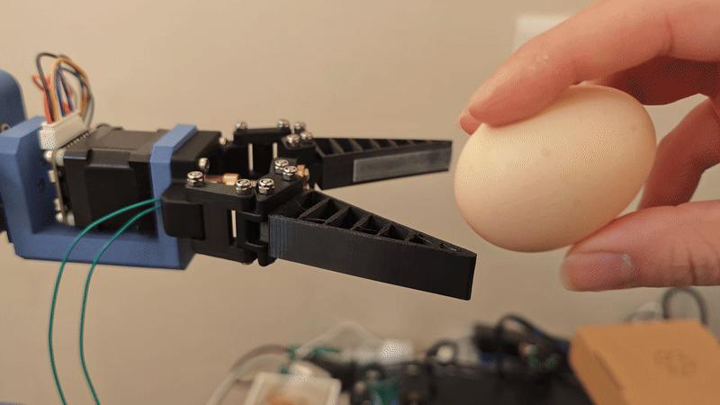
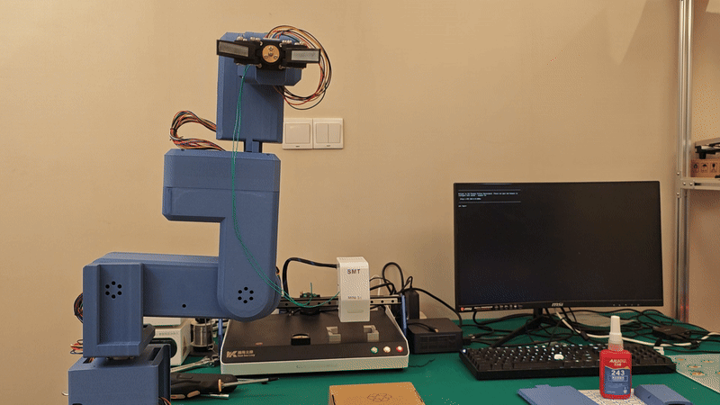
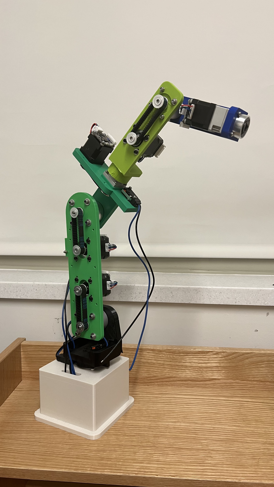
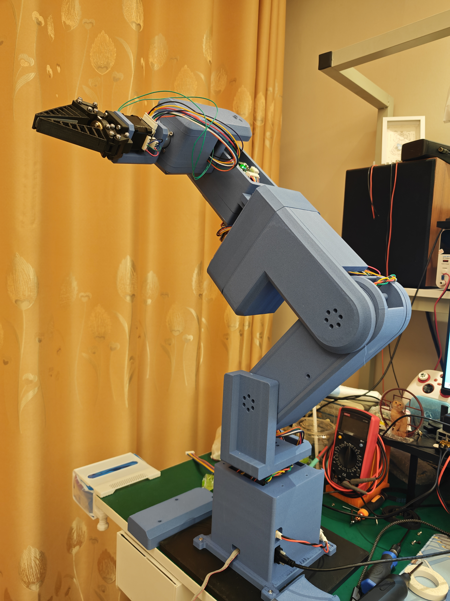
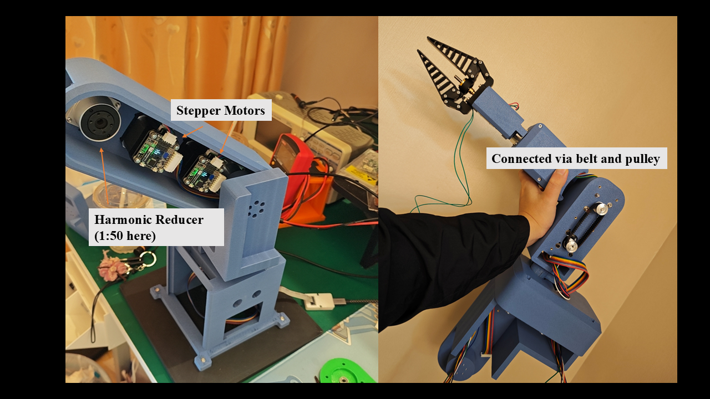

# Dexter — Six-Axis Robotic Arm

Dexter is a six-degree-of-freedom robotic arm with a force-controlled gripper, a **PETG-CF 3D-printed structure**, custom controller electronics, and embedded C firmware. The project brings together mechanical design, PCB design, motor communications, and feedback control—from an early prototype to a fully assembled arm that can hold an egg without breaking it.

I designed, built, assembled, programmed, and tested Dexter independently. The stepper-driven arm and the firmware in this repository are the completed, tested first version of an ongoing robotics project. I am now developing a second version with BLDC motors to improve motion quality, control performance, and overall results.

**Core technologies:** KiCad · STM32H562 / Arm Cortex-M33 · C11 · RS485 · PID control · Motor current feedback · CMake

## Demonstrations

| Gentle grasping | Arm motion |
| --- | --- |
|  |  |
| A PID force loop regulates the grip to hold an egg without breaking it. | A wave demonstration shows the assembled arm in motion. |

The egg demonstration highlights the central controls challenge: applying enough force to retain a delicate object while limiting additional closing motion after contact.

## Mechanical Design

| Early prototype | Fully assembled arm |
| --- | --- |
|  |  |
| An early build used to develop the mechanical arrangement. | The completed assembly integrates the joints, housings, wiring, and gripper. |

- **Printed structure:** PETG-CF (carbon-fiber-filled PETG) forms the arm's structural parts and housings, with metal motors, reducers, bearings, and fasteners integrated into the assembly.
- **Six articulated joints plus a gripper:** Seven addressed motor axes separate arm positioning from grasp-force control.
- **Harmonic reduction:** Reducers transmit motor motion to the joints. J1–J3 use 42 mm motors with 50:1 reduction, and J4–J6 use 35 mm motors with 30:1 reduction.
- **Internal belt-and-pulley transmission:** Belts transfer motion within the links, allowing motors and transmission components to fit inside the printed structure.
- **Portable mechanical deliverable:** The [Dexter STEP assembly](CAD/DexterAssembly.STEP) can be inspected in standard CAD tools.

<p align="center">
  
</p>

*Inside the housings: stepper motors, harmonic reduction, and the pulley structure that drives the arm.*

## Electronics

The [KiCad controller project](PCB/main_controller/dexter_pcb.kicad_pro) includes the schematic, PCB layout, component libraries, footprints, and 3D models.

The stepper motors have built-in drivers from **ZDT**, so the STM32 can send movement commands directly over RS485 and read back position, speed, and motor current. Each motor has its own address on the bus.

| Subsystem | Implementation |
| --- | --- |
| Main controller | STM32H562 microcontroller running the arm application and peripheral interfaces. |
| Power | 24 V input through an XT60 connector and an AP63203 regulator for the 3.3 V logic supply. |
| Motor bus | MAX3485 RS485 transceiver; firmware addresses joints as 1–6 and the gripper as 7 at 115200 baud. |
| Grip feedback | The claw motor's built-in phase-current feedback, read over RS485 in milliamps and used as a proxy for grip load. |
| Development interfaces | Debug/programming connections, reset/boot circuitry, and a serial command console. |
| External stop input | PC13 accepts a normally closed emergency-stop loop; an open input requests a stop. This connection is external to the current controller PCB. |

The firmware pin assignments match the controller PCB: PA0/PA1 carry the UART4 motor bus, PA2 controls the MAX3485 transmit enable, and PB5/PB6 provide the UART5 serial console.

## Firmware and Control

The firmware uses a bare-metal C11 application with separate board, protocol, joint-control, gripper-control, and scheduling layers.

### Joint motion and motor feedback

[arm.c](Firmware/App/Src/arm.c) converts joint angles and speeds into motor commands using each joint's reduction and direction. It supports absolute joint moves, configurable travel and speed limits, manual reference capture, explicit arming, and individual or whole-arm stops. Feedback monitoring checks following error, lack of progress, motion deadlines, stale telemetry, and driver faults.

[zdt.c](Firmware/App/Src/zdt.c) implements the ZDT **X-firmware** protocol over RS485, including trapezoidal position moves, current-limited commands, configuration checks, and telemetry decoding. Transactions validate reply framing and acknowledgements, use bounded timeouts, and avoid automatic motion retries. Decoded feedback includes position, speed, following error, current, voltage, temperature, and driver status.

### Force-controlled gripper

[gripper.c](Firmware/App/Src/gripper.c) uses the claw stepper's built-in phase-current feedback as a proxy for grip load. The application polls aggregate status from motor 7 every 20 ms, obtaining current, position, speed, and driver flags together.

The outer PID turns measured phase current into small opening or closing corrections:

1. Ramp the current target gradually to soften initial contact.
2. Filter measured current and its derivative to reduce noise.
3. Apply PID control with derivative on measurement, integral anti-windup, and a current deadband.
4. Accumulate small corrections at the drive's 0.1° resolution, with a maximum requested step of 0.2°.
5. Wait for fresh motor feedback and completion of the previous move before issuing another correction. If a closing step reaches the requested load while stationary before its endpoint, stop the remaining step and read feedback again so the loop can hold or release.

The application dispatches finite, current-limited position moves (`0xCD`), using the drive's internal control loops. Unfiltered current limits, reply freshness, and gripper travel checks remain active while a move is pending. Communication errors, driver faults, or loss of the claw's volatile reference marker stop operation. The installed motors run **X firmware in closed-loop mode**.

Current is a proxy for motor torque and grip load, not a calibrated jaw-force measurement in newtons. Friction, jaw geometry, and direction affect the relationship. `GRIP` takes **milliamps**. The tested configuration uses a 100 mA maximum target, 150 mA drive limit/software trip, 40 mA/s target ramp, and 3 mA deadband. These limits and the PID gains are used by the completed stepper-driven arm, including the gentle grasping demonstration above. Limits live in [robot_config.h](Firmware/App/Inc/robot_config.h), and PID defaults in [gripper.c](Firmware/App/Src/gripper.c).

### Scheduling, diagnostics, and fault handling

- **100 Hz application scheduling target:** Late updates skip missed releases. Blocking motor transactions affect the achieved rate; one arm joint is polled per update.
- **At most 50 Hz PID corrections:** A 20 ms minimum interval, fresh samples, and motor completion determine the actual correction rate.
- **500 ms nominal independent watchdog:** Refreshed only after a completed application update. Startup requests motor stops and leaves motion disarmed.
- **Observable runtime:** `STATUS` reports joint positions and targets, claw phase current and target in mA, feedback validity and age, faults, measured loop frequency, missed releases, longest update, and watchdog-reset status.
- **Buffered serial console:** Interrupt-driven receive/transmit queues keep console traffic separate from command processing; damaged or oversized input lines are discarded.

Current application motion is joint-space control with manual referencing; Cartesian inverse kinematics, automatic homing, and coordinated trajectory planning are not implemented.

## Build and Explore

Start with the [Dexter STEP assembly](CAD/DexterAssembly.STEP) for the mechanism, the [KiCad schematic](PCB/main_controller/dexter_pcb.kicad_sch) for electronics, and [robot_app.c](Firmware/App/Src/robot_app.c) for application behavior.

### Build the firmware

Requires CMake 3.22+, Ninja, and the GNU Arm Embedded toolchain (`arm-none-eabi-*`) on `PATH`. From the repository root:

```sh
cd Firmware
cmake --preset Debug
cmake --build --preset Debug
```

Outputs are `build/Debug/dexter_legacy.elf`, `.hex`, and `.bin`. A `Release` preset is also provided. [dexter_legacy.ioc](Firmware/dexter_legacy.ioc) contains the STM32CubeMX project configuration.

### Run host tests

The tests run on a computer without connecting the arm. With CMake and a native C compiler, run from the repository root:

```sh
cmake -S Firmware/tests -B Firmware/build/host-tests
cmake --build Firmware/build/host-tests --config Debug
ctest --test-dir Firmware/build/host-tests -C Debug --output-on-failure
```

The claw tests check that it closes when current is low, opens when current is high, and stops on too much current or old feedback. There are also tests for the motor protocol and loop timing. The full firmware has also been tested on the assembled arm; the demonstrations at the top of this page show the resulting motion and grip control.

### Serial operation

Connect a 3.3 V serial adapter to the console at **115200 baud, 8N1**. Commands are uppercase and newline-terminated.

| Command | Purpose |
| --- | --- |
| `HELP`, `STATUS` | Show commands or runtime diagnostics. |
| `ZERO`, `ARM` | Capture the manually positioned zero pose, then permit motion. Place the gripper fully open before `ZERO`. |
| `MOVE joint degrees deg/s` | Move one joint to an absolute angle relative to the captured zero. |
| `GRIP milliamps`, `OPEN` | Regulate measured motor phase current (default range: greater than 0 through 100 mA), or return the gripper to its open reference. |
| `DEMO` | From the zero pose, move each joint sequentially to 5° and back at 2°/s. This is a commissioning routine separate from the wave GIF. |
| `STOP [joint]`, `DISARM`, `CLEAR` | Stop all axes or one axis (1–7), stop and disarm, or clear a fault while disarmed. |

After placing the joints at zero and the claw fully open, use `ZERO`, then `ARM`, then select a tested `GRIP` target in mA. The position reference is lost on reset. Stop commands preserve motor enable where possible, but software stops and the MCU watchdog cannot guarantee holding torque after power or communication loss; gravity-loaded joints need physical support during commissioning.

## Repository Map

| Path | Contents |
| --- | --- |
| [CAD/](CAD/) | Portable STEP assembly of the complete mechanism. |
| [PCB/main_controller/](PCB/main_controller/) | KiCad controller design and supporting libraries. |
| [Firmware/App/](Firmware/App/) | Motor protocol, arm and gripper controllers, command interface, and scheduler. |
| [Firmware/Board/](Firmware/Board/) | UART/RS485, external stop-input, and watchdog interfaces. |
| [Firmware/Core/](Firmware/Core/) | STM32 startup and system initialization; vendor support resides in `Firmware/Drivers/`. |
| [Firmware/tests/](Firmware/tests/) | C tests for the motor protocol, claw control, and loop timing. |
| [README/](README/) | Demonstration GIFs and photographs of the design process and assembly. |
